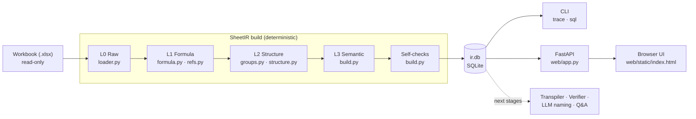

# SheetTwin — SheetIR

**SheetIR** is the first stage of SheetTwin, a local system that turns business
spreadsheets into verified, explainable digital twins. SheetIR parses an Excel workbook into a layered,
queryable **intermediate representation (IR)** stored in a single SQLite file. Every later stage (Python
transpilation, verification, explanations, Q&A) is built on this IR.

All analysis is **deterministic Python**. No LLM is involved yet, and no data leaves the machine.

> **Status: proof of concept (v0.1).** SheetIR parses, structures and audits a workbook. It does **not yet
> compute** anything: there is no Python translation, no L1/L2 verification, and no LLM naming or Q&A.
> See [Status and roadmap](#status-and-roadmap).

---

## Contents

- [What it does](#what-it-does)
- [Quick start](#quick-start)
- [Web UI](#web-ui)
- [Command line](#command-line)
- [Architecture](#architecture)
- [How the analysis works](#how-the-analysis-works)
- [Storage format](#storage-format)
- [Detected issues](#detected-issues)
- [Self-checks](#self-checks)
- [Example queries](#example-queries)
- [Project layout](#project-layout)
- [Testing](#testing)
- [Status and roadmap](#status-and-roadmap)

---

## What it does

Given an `.xlsx` workbook, SheetIR produces:

| Output | Example (bundled sample workbook) |
|---|---|
| Every non-empty cell with its **role** | 251 cells classified as input, derived, output, label or orphan |
| **Formula groups**: cells that perform the same computation | 108 formulas → 13 groups (e.g. the 21-cell *Margin* column is one group) |
| **Tables** with a key column, fields and total row | `quote` (20 products, key = *Product*), `materials` |
| **Parameters** named from nearby labels, with units and allowed range | `copper_price` (TWD/kg, 100–1000), `labor_rate` (from defined name `LaborRate`) |
| A **semantic address** for every cell | `Quote!J13` → `quote["Cover plate"].margin` |
| The **dependency graph** | Trace any number back to its inputs |
| **Issues** found during parsing | Inconsistent formula in a column, constant typed over a formula, hard-coded `1.15`, unused values, `TODAY()`, `INDIRECT` |
| **Self-check** results | Formula coverage, independent re-derivation of groups, cycle detection |

The original workbook is never modified.

---

## Quick start

Requirements: [uv](https://docs.astral.sh/uv/) (it installs Python 3.11+ and all dependencies) and
[Node.js](https://nodejs.org/) 20+ for the chat UI.

```bash
uv sync                      # create .venv and install dependencies

# build the chat UI once (and again after changing frontend/)
cd frontend
npm install
npm run build                # writes sheetir/web/static/app (git-ignored)
cd ..

uv run sheetir serve         # http://127.0.0.1:8765
```

| URL | Page |
|---|---|
| `http://127.0.0.1:8765/` | Chat UI: talk to a workbook, upload new data, browse converted files |
| `http://127.0.0.1:8765/legacy` | Structure browser: grid, issues, model, SQL |

The built chat UI is not committed, so after cloning you need the `npm run build` step. Without it, `/`
shows the structure browser instead.

Without Node, skip the `frontend` step and use the structure browser.

### Working on the chat UI

Run the backend and the Next.js dev server side by side. The dev server reloads on every change and
proxies `/api` to the backend:

```bash
uv run sheetir serve         # terminal 1: backend on :8765
cd frontend && npm run dev   # terminal 2: open http://localhost:3000
```

Set `SHEETIR_API` if the backend is not on `http://127.0.0.1:8765`. When you are done, run
`npm run build` so `sheetir serve` picks up the changes.

In the UI, either drop in an `.xlsx` file or load the sample workbook.

Without the UI:

```bash
uv run sheetir sample samples/quotation.xlsx            # generate the sample workbook
uv run sheetir build  samples/quotation.xlsx -o out/q.db
uv run sheetir trace  out/q.db "Quote!J13" --depth 2
uv run sheetir sql    out/q.db "SELECT cell_id, kind, detail FROM issues"
```

### Sample workbook

`sheetir sample` writes a synthetic quotation workbook (4 sheets, 20 products) with deliberately planted problems:

| Cell | Planted problem | Detected as |
|---|---|---|
| `Quote!I13` | Overhead factor 1.12 instead of 1.15 | `inconsistent_formula` |
| `Quote!G17` | Labor cost typed as `3250` in a formula column | `hardcoded_in_formula_column` |
| `Quote!I*` | Overhead `1.15` hard-coded in 19 formulas | `hardcoded_constant` |
| `Inputs!B9` | Value that no formula uses | `orphan` |
| `Report!B1` | `=TODAY()` | `volatile` |
| `Report!B6` | `=INDIRECT(...)` | `dynamic_ref` |

As a side effect, SheetIR also flags `Quote!E17` as an orphan: because `G17` was typed over, that row's labor hours no longer affect anything.

---

## Web UI

`uv run sheetir serve` starts a local FastAPI server that serves two pages and the HTTP API. Neither page loads anything from a CDN or makes external requests, so both work offline.

| Option | Default | Meaning |
|---|---|---|
| `--host` | `127.0.0.1` | Use `0.0.0.0` to share with colleagues on the LAN |
| `--port` | `8765` | |
| `--data` | `data` | Where uploads and IR databases are stored |

**Chat UI (`/`)**, built from `frontend/` (Next.js, React, Tailwind):

| Part | Contents |
|---|---|
| **新增資料** button | Upload dialog: drag and drop an `.xlsx`/`.xlsm`, or load the sample workbook |
| **轉換檔案** button | Files derived from the workbook (original, `ir.db`, `model.json`, CSVs), with preview and download |
| **依賴圖** button | Dependency graph. *Overview*: one node per formula group, table data column or standalone input, so a filled-down column is a single node. *Cell trace*: a cell's precedents (3 levels up) and dependents (2 levels down). Hovering a node highlights its whole calculation chain; nodes with issues get a badge |
| **圖表** button | Charts. Structure and audit: cell roles and issue severity (donuts), issue kinds, cells and formulas per sheet. Table data: pick a detected table and a numeric column, shown per row (bars) or summed by a text column (donut or bars), with a data-table view. Formula columns only have values if the file was last saved by Excel |
| Workbook list | Each workbook keeps its own chat history (stored in the browser) |
| Chat | Answers about the summary, issues, parameters, tables, outputs, checks, or a cell such as `Quote!J13`. Cell ids in a reply are clickable, and replies about a cell link to its dependency graph |

The chat is rule-based for now (`sheetir/web/chat.py`). The LLM Q&A stage will replace `answer()` there.

The UI is bilingual: the **中 / EN** button at the bottom of the left rail switches between Traditional Chinese
and English, including chat replies (`lang` in the chat request). UI strings live in
`frontend/src/lib/i18n.tsx`, reply strings in `MSG` in `chat.py`. The choice is remembered in the browser.

**Structure browser (`/legacy`)**, the single file `sheetir/web/static/index.html`:

| Tab | Contents |
|---|---|
| **Sheets** | Spreadsheet-like grid colored by cell role, with issue cells outlined. Clicking a cell shows its formula, R1C1 form, semantic name, issues, precedents and dependents. Cells in the same formula group are marked, and direct precedents get a dashed outline. Every reference is clickable, including references to other sheets. |
| **Issues** | All issues, filterable by severity; click to jump to the cell |
| **Model** | The semantic view: parameters (value, unit, domain), tables and their fields with R1C1 formulas, outputs, formula groups |
| **SQL** | Ad-hoc SQL against the IR, with preset queries. Only `SELECT`/`WITH` is accepted, and the database is opened read-only |

### HTTP API

| Method | Path | Returns |
|---|---|---|
| `GET` | `/api/workbooks` | Parsed workbooks, newest first |
| `POST` | `/api/workbooks` | Upload (`multipart/form-data`, field `file`) and parse |
| `POST` | `/api/workbooks/sample` | Generate and parse the sample workbook |
| `GET` | `/api/workbooks/{id}/summary` | Metadata, counts, checks, issue counts |
| `GET` | `/api/workbooks/{id}/sheet?name=` | Cells and issues of one sheet |
| `GET` | `/api/workbooks/{id}/cell?id=&depth=` | One cell with its group, issues, precedents and dependents |
| `GET` | `/api/workbooks/{id}/issues` | All issues |
| `GET` | `/api/workbooks/{id}/model` | Tables, fields, parameters, outputs, groups |
| `POST` | `/api/workbooks/{id}/sql` | `{"query": "..."}` → columns and rows (max 500) |
| `POST` | `/api/workbooks/{id}/chat` | `{"message": "...", "lang": "zh" \| "en"}` → `{"reply": markdown, "cells": [...]}` |
| `GET` | `/api/workbooks/{id}/graph?cell=&up=&down=` | Block-level dependency graph; with `cell`, that cell's neighbourhood |
| `GET` | `/api/workbooks/{id}/charts` | Role/issue/sheet statistics and the rows of every table (constants, or cached values for formulas) |
| `GET` | `/api/workbooks/{id}/exports` | Converted files: name, label, format, size |
| `GET` | `/api/workbooks/{id}/exports/{name}` | Download one file (`ir.db`, `model.json`, `cells.csv`, `issues.csv`, `formula_groups.csv`, or the original workbook) |

---

## Command line

| Command | Description |
|---|---|
| `sheetir sample [OUT]` | Write the sample workbook (default `samples/quotation.xlsx`) |
| `sheetir build XLSX [-o DB]` | Parse a workbook; prints counts, checks and issues. Exits with code 1 if an error-level check fails |
| `sheetir trace DB CELL [--depth N]` | Print the precedent tree of a cell, e.g. `Quote!J13` |
| `sheetir sql DB QUERY` | Run SQL against an IR database |
| `sheetir serve [--host] [--port] [--data]` | Start the web UI |

`python -m sheetir ...` works as well.

---

## Architecture



The IR has four layers. Each layer is derived from the one below it:

| Layer | Holds | Built by |
|---|---|---|
| **L0 Raw** | Cells, constants, formulas, cached values, number formats, Excel Tables, defined names, data validation | `loader.py` |
| **L1 Formula** | Tokens, resolved references (A1, cross-sheet, defined names, `Table[Column]`), R1C1 templates, literals, dependency edges | `formula.py`, `refs.py` |
| **L2 Structure** | Formula groups, tables (header, key column, total row, fields), cell roles, anomalies | `groups.py`, `structure.py` |
| **L3 Semantic** | Names for parameters, fields and outputs; semantic address of every cell | `build.py` (slugs from labels; LLM renaming is a later stage) |

---

## How the analysis works

### 1. Read the workbook (L0)

`openpyxl` opens the file **twice**: once for formulas and once with `data_only=True` for the values Excel last calculated. The cached values are the ground truth for later L1 parity checks. The loader also reads Excel Tables, defined names (global and sheet-scoped), data validation rules and merged ranges. Array formulas and data tables are flagged.

### 2. Parse formulas and normalize references (L1)

Each formula is split by openpyxl's tokenizer. Range operands are then resolved:

- **A1 references**, including `$` anchors, whole columns/rows and quoted sheet names, are parsed by `refs.parse_ref`.
- **Defined names** are resolved to their target ranges.
- **Structured references** (`Sales[Amount]`, `[@Qty]`, `Sales[[#This Row],[Price]]`) are resolved against Excel Tables.
- **External links**, `#REF!`, unknown sheets and unresolvable names become issues.

Every reference is converted to **relative R1C1 form**, which makes a formula independent of its position:

```
F2:  =D2*E2*$H$1   →  =RC[-2]*RC[-1]*R1C8
F3:  =D3*E3*$H$1   →  =RC[-2]*RC[-1]*R1C8     same key = same computation
```

Ranges are kept as single nodes and are not expanded cell by cell, so `VLOOKUP(x, A1:Z10000, …)` adds one edge, not 260,000. Numeric literals are recorded with the function that encloses them. This lets the auditor ignore structural arguments such as a `VLOOKUP` column index.

### 3. Group formulas (L2)

Adjacent cells with identical R1C1 keys are grouped: first down columns (`axis = col`), then across rows (`axis = row`). Anything left over becomes a single-cell group. A group is one vectorizable computation. Later stages name, explain and translate groups, not thousands of individual cells.

### 4. Detect tables and roles (L2)

- **Tables**: declared Excel Tables are used first. Otherwise a table is detected from a row of two or more adjacent text cells (the header) above at least two rows containing numbers or formulas. Header cells that a formula references individually are treated as input values, not headers. A trailing row with a "Total" label, or an aggregate over the column above, becomes the **total row**. The first all-text, unique column becomes the **key column**.
- **Fields**: a column whose cells are mostly formulas is `derived`, and its majority R1C1 key is the column's pattern. Cells that break the pattern are reported as issues.
- **Roles** come from the dependency graph:

| Role | Rule |
|---|---|
| `input` | Constant that a formula references |
| `derived` | Formula that another formula references |
| `output` | Formula that nothing references |
| `label` | Text that nothing references |
| `orphan` | Non-text constant that nothing references |

### 5. Name things (L3)

- **Parameters**: inputs outside tables. Each is named from the label to its left (or above) or from a defined name, and labels like `Copper price (TWD/kg)` are split into a name (`copper_price`) and a unit (`TWD/kg`). Data validation rules become the parameter's domain. A two-column *label | value* block whose values are referenced one by one is treated as a parameter list.
- **Table cells**: `table["row key"].field`, and `table.total.field` for total rows.
- **Other formulas**: `outputs.<label>` or `calc.<label>`.

Names are deterministic slugs. A later stage will let an LLM propose better names; only names change, never structure.

---

## Storage format

### Location

| Used from | Location |
|---|---|
| CLI | Path given with `-o`, default `<workbook>.sheetir.db` next to the workbook |
| Web UI | `data/<id>/ir.db`, plus a copy of the uploaded file in `data/<id>/`; `<id>` is the first 12 hex characters of the file's SHA-256 |

Each build **replaces** the previous database at that path; version history is not kept yet. `data/`, `out/` and `*.sheetir.db` are git-ignored.

### Schema

One SQLite file per workbook. Every table is keyed by a canonical cell id such as `Quote!J13` or `'My Sheet'!A1`.

| Table | One row per | Key columns |
|---|---|---|
| `meta` | Build attribute | `source`, `sha256`, `sheetir_version`, `sheets` (ordered JSON list), `built_at` |
| `cells` | Non-empty cell | `cell_id`, `sheet`, `row`, `col`, `vtype`, `role`, `value`, `cached`, `formula`, `r1c1`, `group_id`, `table_id`, `semantic`, `number_format` |
| `formula_groups` | Formula group | `group_id`, `axis`, `anchor`, `last`, `n_cells`, `r1c1`, `template` (tokens + relative refs, JSON) |
| `edges` | Reference in a formula | `src_kind` (`cell`/`range`), `src_id`, `dst_cell`, `via` (`direct`, `name:<NAME>`, `structured`) |
| `ranges` | Distinct multi-cell range | `range_id` (e.g. `Quote!J2:J21`), bounds |
| `range_cells` | Non-empty cell inside a range | `range_id`, `cell_id` |
| `literals` | Numeric literal in a formula | `cell_id`, `value`, `function` (enclosing call) |
| `tables` | Detected or declared table | `name`, `kind` (`data`/`parameter_list`), `source` (`detected`/`listobject`), header/data/total rows, `key_col` |
| `fields` | Table column | `name`, `header`, `unit`, `kind` (`data`/`derived`), `r1c1` (column pattern) |
| `params` | Parameter | `cell_id`, `label`, `name`, `unit`, `domain` (JSON) |
| `names` | Defined name | `name`, `scope`, `refers_to` |
| `issues` | Finding | `cell_id`, `group_id`, `kind`, `severity`, `detail` |
| `checks` | Self-check | `name`, `passed`, `severity`, `detail` |

View **`deps(src_cell, dst_cell, via)`** combines cell edges and range edges into cell-level dependencies, with ranges expanded through `range_cells`. Tracing uses a recursive CTE over this view (`store.TRACE_SQL`).

Note: `value`, `cached`, `template` and `domain` are stored as JSON text, so dates come back as strings. Use `json_extract` or casts when filtering numerically.

---

## Detected issues

| Kind | Severity | Meaning |
|---|---|---|
| `inconsistent_formula` | high | A cell's formula differs from its column's pattern |
| `hardcoded_in_formula_column` | high | A constant where the column otherwise computes a formula |
| `broken_ref` | high | Formula contains `#REF!` |
| `external_link` | high | Reference to another workbook |
| `unknown_sheet` | high | Reference to a sheet that does not exist |
| `parse_error` | high | Formula could not be tokenized |
| `data_table` | high | What-if data table (unsupported) |
| `cycle` | high | Cell is part of a circular reference |
| `missing_formula` | medium | Empty cell inside a derived column |
| `hardcoded_constant` | medium | Business constant inside a formula; one issue per group |
| `dynamic_ref` | medium | `INDIRECT` / `OFFSET`: dependencies cannot be known statically |
| `volatile` | medium | `NOW`, `TODAY`, `RAND`, … |
| `unresolved_ref` / `unresolved_name` | medium | Structured reference or name that could not be resolved |
| `array_formula` | medium | Array (CSE) formula |
| `orphan` | low | Constant that no formula uses |

---

## Self-checks

Every build verifies its own output and stores the results in `checks`:

| Check | Level | Passes when |
|---|---|---|
| `formula_coverage` | error | Every formula cell belongs to exactly one group |
| `group_translation` | error | openpyxl's `Translator`, an independent implementation, re-derives every group member from the group's anchor formula, and the result matches the original text |
| `acyclic` | error | No circular references |
| `references_resolved` | warning | All names and structured references resolve |
| `cached_values_present` | warning | Every formula cell has a value cached by Excel. Files written by openpyxl, including the sample, have none; save the file in Excel to get them |

---

## Example queries

```sql
-- Hard-coded constants, ignoring structural arguments
SELECT value, COUNT(*) AS n_cells, MIN(cell_id) AS example
FROM literals
WHERE value NOT IN (0, 1, 100) AND (function IS NULL OR function NOT IN ('VLOOKUP','INDEX','MATCH','ROUND'))
GROUP BY value ORDER BY n_cells DESC;

-- Full calculation chain of one cell
WITH RECURSIVE trace(cell_id, depth) AS (
  SELECT 'Quote!J2', 0
  UNION SELECT d.src_cell, t.depth + 1 FROM deps d JOIN trace t ON d.dst_cell = t.cell_id
)
SELECT t.cell_id, MIN(depth) AS depth, c.semantic, c.formula
FROM trace t LEFT JOIN cells c USING(cell_id)
GROUP BY t.cell_id ORDER BY depth;

-- Which parameters feed the most formulas directly
SELECT p.name, COUNT(DISTINCT d.dst_cell) AS direct_dependents
FROM params p JOIN deps d ON d.src_cell = p.cell_id
GROUP BY p.name ORDER BY direct_dependents DESC;

-- The semantic model of a table
SELECT f.name, f.kind, f.unit, f.r1c1
FROM fields f JOIN tables t USING(table_id) WHERE t.name = 'quote' ORDER BY f.col;
```

---

## Project layout

```
SheetTwin/
├── pyproject.toml
├── sheetir/
│   ├── refs.py        A1 parsing, R1C1 relativization, cell ids
│   ├── loader.py      L0: read formulas, cached values, tables, names, validation
│   ├── formula.py     L1: tokenize, resolve references, R1C1 templates, literals
│   ├── groups.py      L2: group identical R1C1 formulas
│   ├── structure.py   L2/L3: tables, fields, roles, anomalies, labels
│   ├── build.py       pipeline, name resolver, issues, self-checks
│   ├── store.py       SQLite schema, writer, trace query
│   ├── sample.py      synthetic quotation workbook with planted errors
│   ├── cli.py         sample | build | trace | sql | serve
│   └── web/
│       ├── app.py             FastAPI backend
│       ├── chat.py            rule-based chat answers (LLM hook later)
│       ├── graph.py           dependency graphs for drawing (overview, cell trace)
│       ├── charts.py          statistics and table rows for the charts view
│       └── static/
│           ├── index.html     structure browser (/legacy)
│           └── app/           chat UI build output (git-ignored)
├── frontend/          chat UI source (Next.js); `npm run build` copies it into static/app
└── tests/
    ├── test_refs.py   reference parsing and R1C1 round trips
    ├── test_build.py  end-to-end build on the sample, Excel Tables, cycles
    └── test_web.py    chat answers, dependency graphs, chart data
```

---

## Testing

```bash
uv run pytest
```

34 tests cover reference parsing, R1C1 round trips, grouping, table and parameter detection, semantic addresses, detection of every planted problem, tracing across sheets and defined names, Excel Tables with structured references, cycle detection, chat answers, dependency graphs and chart data. The HTTP layer and the chat UI are not covered by automated tests yet.

---

## Status and roadmap

| SheetTwin artifact | Status |
|---|---|
| A5 Audit report | **Partial.** Issues are detected and listed; no downloadable report yet |
| A3 Interactive twin web app | **Partial.** Structure browser only; no what-if sliders or recalculation |
| A1 Verified Python model | Not started: transpiler and L1/L2 verification |
| A2 Plain-language specification | Not started: needs the LLM stage |
| A4 Grounded Q&A analyst | Not started |

Next steps, in order:

1. **Transpile** each formula group to Python (vectorized per group) and run **L1 parity** against Excel's cached values. This needs a workbook saved by Excel.
2. **L2 differential testing** against an independent engine (`pycel`), with input domains taken from data validation and observed values.
3. **LLM naming** (Cartographer): propose names for groups, fields and parameters from the packaged context, constrained by a JSON schema.
4. **Storage**: content-addressed version history, a catalog across workbooks, encryption at rest.

### Known limitations

- Table detection supports single-row headers only, and transposed tables are not detected as tables (their formulas still group by row).
- `INDIRECT`/`OFFSET` dependencies are flagged but not resolved.
- 3D references (`Sheet1:Sheet3!A1`) are reported as unresolved names.
- Defined names that hold constants or formulas, rather than ranges, are not resolved.
- The grid view shows at most 400 rows × 52 columns per sheet.
- Heuristics have been tested only on the synthetic sample and small fixtures, not on real-world workbooks yet.
